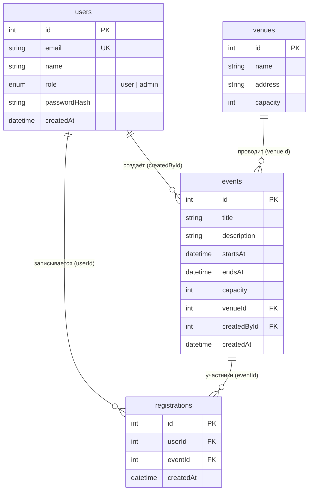

# Events API — REST API для системы управления мероприятиями

Курсовая работа по ПМ4 «Разработка браузерных приложений»  
Специальность 06130100 «Программное обеспечение (по видам)», ТОО «Колледж Хекслет»

Серверное приложение на **Node.js (ES Modules) + Express.js + Prisma ORM + PostgreSQL**.
Система позволяет администраторам управлять площадками и мероприятиями, а зарегистрированным пользователям — записываться на мероприятия.

## Содержание

1. [Возможности](#возможности)
2. [ER-диаграмма](#er-диаграмма)
3. [Структура проекта](#структура-проекта)
4. [Установка и запуск](#установка-и-запуск)
5. [Общие правила API](#общие-правила-api)
6. [Матрица прав доступа](#матрица-прав-доступа)
7. [Документация endpoint](#документация-endpoint)
8. [Проверка работы: JWT, 401, 403, admin](#проверка-работы-jwt-401-403-admin)
9. [Безопасность](#безопасность)

## Возможности

- Регистрация и вход, пароли хешируются **Argon2id**, выдаётся **JWT** (HS256).
- Роли `user` и `admin`; middleware `requireAuth` и `requireRole`.
- Полный CRUD мероприятий и площадок, чтение связанных данных через Prisma `include` / `select`.
- Запись на мероприятия с контролем вместимости и защитой от повторной записи.
- Валидация входных данных (Zod), централизованная обработка ошибок, статусы 200, 201, 400, 401, 403, 404, 409, 500.

## ER-диаграмма



Дополнительно: пара `(userId, eventId)` в `registrations` уникальна. Та же диаграмма в виде изображения: [`docs/er-diagram.png`](docs/er-diagram.png). Полная схема БД — в [`prisma/schema.prisma`](prisma/schema.prisma).

**Правила удаления связей:** площадку с мероприятиями и пользователя-автора мероприятий удалить нельзя (`Restrict`); при удалении мероприятия его записи удаляются каскадом (`Cascade`).

## Структура проекта

```
events-api/
├── prisma/
│   ├── schema.prisma        # схема БД
│   ├── migrations/          # создаётся командой prisma migrate dev
│   └── seed.js              # тестовые данные
├── src/
│   ├── config/              # env, клиент Prisma, русские сообщения Zod
│   ├── routes/              # URL → middleware → контроллер
│   ├── controllers/         # HTTP-слой: читает req, формирует res
│   ├── services/            # бизнес-логика и запросы Prisma
│   ├── middleware/          # requireAuth, requireRole, validate, errorHandler
│   ├── validators/          # схемы Zod
│   ├── utils/               # ApiError, asyncHandler
│   ├── app.js               # сборка Express-приложения
│   └── server.js            # запуск сервера
├── docs/er-diagram.png
├── requests.http            # готовые запросы для проверки
├── .env.example
└── package.json
```

Поток запроса: **Route → (requireAuth → requireRole → validate) → Controller → Service → Prisma → PostgreSQL**.

## Установка и запуск

### 1. Установите Node.js и PostgreSQL

- Node.js 20 или новее: <https://nodejs.org> (проверка: `node -v`).
- PostgreSQL 14 или новее: <https://www.postgresql.org/download/> (проверка: `psql --version`).
- Git: <https://git-scm.com>.

### 2. Клонируйте репозиторий и установите зависимости

```bash
git clone <ссылка-на-ваш-репозиторий>
cd events-api
npm install
```

### 3. Создайте базу данных

Откройте `psql` под суперпользователем (`psql -U postgres`) и выполните:

```sql
CREATE USER events_user WITH PASSWORD 'change_me';
CREATE DATABASE events_db OWNER events_user;
ALTER USER events_user CREATEDB;  -- нужно Prisma для shadow-базы при migrate dev
```

### 4. Настройте `.env`

```bash
cp .env.example .env      # Windows (cmd): copy .env.example .env
```

Заполните `DATABASE_URL` (логин, пароль, имя БД из шага 3) и задайте собственный `JWT_SECRET` не короче 32 символов:

```bash
node -e "console.log(require('crypto').randomBytes(48).toString('hex'))"
```

Файл `.env` добавлен в `.gitignore` и не публикуется.

### 5. Подготовьте Prisma: миграции и тестовые данные

```bash
npx prisma generate                    # генерация Prisma Client
npx prisma migrate dev --name init     # создание таблиц (папку prisma/migrations нужно закоммитить в Git)
npm run db:seed                        # тестовые данные
```

### 6. Запустите API

```bash
npm run dev      # режим разработки (перезапуск при изменениях)
# или
npm start
```

Проверка: <http://localhost:3000/api/health> вернёт `{"status":"ok"}`.

### Тестовые учётные записи (после seed)

| Роль  | Email               | Пароль       |
|-------|---------------------|--------------|
| admin | admin@example.com   | Admin12345   |
| user  | anna@example.com    | User12345    |
| user  | timur@example.com   | User12345    |

Пароли можно изменить в `.env` (`SEED_ADMIN_PASSWORD`, `SEED_USER_PASSWORD`) до запуска seed. Это учётные данные только для разработки. Администратор создаётся именно seed-скриптом, поскольку публичная регистрация выдаёт только роль `user`.

Сброс базы с повторной загрузкой данных: `npm run db:reset`.

## Общие правила API

- Базовый URL: `http://localhost:3000/api`.
- Все запросы с телом и все ответы — JSON; для запросов с телом нужен заголовок `Content-Type: application/json`.
- Защищённые маршруты требуют заголовок `Authorization: Bearer <accessToken>`.
- Даты передаются в формате ISO 8601 (`2026-12-01T10:00:00Z`).
- Лишние поля в теле запроса не игнорируются, а отклоняются с кодом 400.

### Формат ошибок

```json
{
  "error": {
    "status": 400,
    "message": "Ошибка валидации входных данных",
    "details": [
      { "field": "email", "message": "Некорректный email" }
    ]
  }
}
```

Поле `details` присутствует только при ошибках валидации.

### Коды ответов

| Код | Значение |
|-----|----------|
| 200 | Успешно (чтение, изменение, удаление) |
| 201 | Ресурс создан |
| 400 | Некорректные данные запроса |
| 401 | Нет токена, токен недействителен или истёк, неверный email/пароль |
| 403 | Недостаточно прав |
| 404 | Ресурс не найден |
| 409 | Конфликт (дубликат, нет мест, нарушение связей) |
| 500 | Внутренняя ошибка сервера (подробности только в логе сервера) |

## Матрица прав доступа

| Действие | guest | user | admin |
|---|:---:|:---:|:---:|
| Просмотр мероприятий и площадок | ✅ | ✅ | ✅ |
| Регистрация и вход | ✅ | ✅ | ✅ |
| Запись на мероприятие, просмотр и отмена своих записей | ❌ 401 | ✅ | ✅ |
| Отмена чужой записи | ❌ 401 | ❌ 403 | ✅ |
| Создание, изменение, удаление мероприятий и площадок | ❌ 401 | ❌ 403 | ✅ |
| Просмотр списка участников мероприятия | ❌ 401 | ❌ 403 | ✅ |

## Документация endpoint

Сводная таблица:

| Метод | URL | Доступ |
|---|---|---|
| POST | `/api/auth/register` | guest |
| POST | `/api/auth/login` | guest |
| GET | `/api/events` | guest |
| GET | `/api/events/:id` | guest |
| POST | `/api/events` | admin |
| PATCH | `/api/events/:id` | admin |
| DELETE | `/api/events/:id` | admin |
| GET | `/api/venues` | guest |
| GET | `/api/venues/:id` | guest |
| POST | `/api/venues` | admin |
| PATCH | `/api/venues/:id` | admin |
| DELETE | `/api/venues/:id` | admin |
| POST | `/api/events/:id/registrations` | user, admin |
| GET | `/api/events/:id/registrations` | admin |
| GET | `/api/registrations/my` | user, admin |
| DELETE | `/api/registrations/:id` | владелец записи, admin |

Служебный маршрут `GET /api/health` возвращает `{"status":"ok"}` и используется для проверки запуска.

Условный токен в примерах: `eyJhbGciOiJIUzI1NiIsInR5cCI6IkpXVCJ9.<payload>.<signature>`.

---

### Аутентификация

#### POST `/api/auth/register`

Регистрация нового пользователя. Роль всегда `user`; передать `role` нельзя.

- **Доступ:** guest
- **Заголовки:** `Content-Type: application/json`
- **Параметры:** нет

**Request Body**

```json
{
  "email": "student@example.com",
  "name": "Айдар Нурлан",
  "password": "StrongPass1"
}
```

Правила: `email` — корректный адрес (приводится к нижнему регистру); `name` — 2–100 символов; `password` — 8–128 символов.

**Response Body — 201 Created**

```json
{
  "user": {
    "id": 4,
    "email": "student@example.com",
    "name": "Айдар Нурлан",
    "role": "user",
    "createdAt": "2026-11-12T08:30:00.000Z"
  }
}
```

**Ошибки:** 400 — невалидные данные или передано лишнее поле (например, `role`); 409 — email уже зарегистрирован.

#### POST `/api/auth/login`

Вход по email и паролю, выдача JWT.

- **Доступ:** guest
- **Заголовки:** `Content-Type: application/json`

**Request Body**

```json
{
  "email": "admin@example.com",
  "password": "Admin12345"
}
```

**Response Body — 200 OK**

```json
{
  "accessToken": "eyJhbGciOiJIUzI1NiIsInR5cCI6IkpXVCJ9.<payload>.<signature>",
  "tokenType": "Bearer",
  "expiresIn": "1h",
  "user": {
    "id": 1,
    "email": "admin@example.com",
    "name": "Администратор",
    "role": "admin",
    "createdAt": "2026-11-12T08:00:00.000Z"
  }
}
```

**Ошибки:** 400 — невалидные данные; 401 — неверный email или пароль (сообщение одинаково для обоих случаев).

---

### Мероприятия

#### GET `/api/events`

Список мероприятий с площадкой и числом записей, сортировка по дате начала.

- **Доступ:** guest, user, admin
- **Заголовки:** не требуются

**Query-параметры (все необязательные)**

| Параметр | Тип | Описание |
|---|---|---|
| `from` | дата ISO 8601 | начало не раньше указанной даты |
| `to` | дата ISO 8601 | начало не позже указанной даты |
| `venueId` | целое > 0 | только мероприятия площадки |
| `page` | целое ≥ 1 (по умолчанию 1) | номер страницы |
| `limit` | целое 1–100 (по умолчанию 20) | размер страницы |

Пример: `GET /api/events?venueId=1&from=2026-12-01T00:00:00Z&page=1&limit=10`

**Response Body — 200 OK**

```json
{
  "data": [
    {
      "id": 1,
      "title": "Meetup по Node.js",
      "description": "Доклады о REST API и Prisma",
      "startsAt": "2026-11-19T10:00:00.000Z",
      "endsAt": "2026-11-19T13:00:00.000Z",
      "capacity": 100,
      "venueId": 1,
      "createdById": 1,
      "createdAt": "2026-11-12T08:00:00.000Z",
      "venue": { "id": 1, "name": "Конференц-зал «Алатау»", "address": "г. Алматы, пр. Аль-Фараби, 77" },
      "registeredCount": 2
    }
  ],
  "meta": { "page": 1, "limit": 20, "total": 3, "totalPages": 1 }
}
```

**Ошибки:** 400 — неверный формат параметров запроса.

#### GET `/api/events/:id`

Мероприятие с площадкой, автором и числом записей (Prisma `include`).

- **Доступ:** guest, user, admin
- **Параметры пути:** `id` — целое > 0

**Response Body — 200 OK**

```json
{
  "id": 1,
  "title": "Meetup по Node.js",
  "description": "Доклады о REST API и Prisma",
  "startsAt": "2026-11-19T10:00:00.000Z",
  "endsAt": "2026-11-19T13:00:00.000Z",
  "capacity": 100,
  "venueId": 1,
  "createdById": 1,
  "createdAt": "2026-11-12T08:00:00.000Z",
  "venue": { "id": 1, "name": "Конференц-зал «Алатау»", "address": "г. Алматы, пр. Аль-Фараби, 77", "capacity": 200 },
  "createdBy": { "id": 1, "name": "Администратор" },
  "registeredCount": 2
}
```

**Ошибки:** 400 — `id` не число; 404 — мероприятие не найдено.

#### POST `/api/events`

Создание мероприятия. Автор (`createdById`) определяется по токену.

- **Доступ:** admin
- **Заголовки:** `Authorization: Bearer <accessToken>`, `Content-Type: application/json`

**Request Body**

```json
{
  "title": "Курс по Prisma ORM",
  "description": "Практическое занятие",
  "startsAt": "2026-12-10T09:00:00Z",
  "endsAt": "2026-12-10T12:00:00Z",
  "capacity": 40,
  "venueId": 2
}
```

Правила: `title` 3–150 символов; `description` до 2000 символов (необязательно); `endsAt` позже `startsAt`; `capacity` — целое > 0 и не больше вместимости площадки.

**Response Body — 201 Created**

```json
{
  "id": 4,
  "title": "Курс по Prisma ORM",
  "description": "Практическое занятие",
  "startsAt": "2026-12-10T09:00:00.000Z",
  "endsAt": "2026-12-10T12:00:00.000Z",
  "capacity": 40,
  "venueId": 2,
  "createdById": 1,
  "createdAt": "2026-11-12T09:00:00.000Z",
  "venue": { "id": 2, "name": "Коворкинг «Хаб»", "address": "г. Алматы, ул. Тимирязева, 42" }
}
```

**Ошибки:** 400 — невалидные данные, `endsAt` ≤ `startsAt`, `capacity` больше вместимости площадки; 401 — нет или неверный токен; 403 — роль не admin; 404 — площадка не найдена.

#### PATCH `/api/events/:id`

Частичное изменение мероприятия. Передайте хотя бы одно поле из набора POST.

- **Доступ:** admin
- **Заголовки:** `Authorization: Bearer <accessToken>`, `Content-Type: application/json`

**Request Body**

```json
{ "capacity": 60, "title": "Курс по Prisma ORM (обновлено)" }
```

**Response Body — 200 OK:** обновлённое мероприятие (структура как в POST).

**Ошибки:** 400 — невалидные данные, пустое тело, нарушение правил дат/вместимости; 401; 403; 404 — мероприятие или площадка не найдены; 409 — новая вместимость меньше числа уже записанных участников.

#### DELETE `/api/events/:id`

Удаление мероприятия вместе с его записями.

- **Доступ:** admin
- **Заголовки:** `Authorization: Bearer <accessToken>`

**Response Body — 200 OK**

```json
{ "message": "Мероприятие удалено" }
```

**Ошибки:** 400; 401; 403; 404.

---

### Площадки

#### GET `/api/venues`

- **Доступ:** guest, user, admin

**Response Body — 200 OK**

```json
{
  "data": [
    { "id": 1, "name": "Конференц-зал «Алатау»", "address": "г. Алматы, пр. Аль-Фараби, 77", "capacity": 200 }
  ]
}
```

#### GET `/api/venues/:id`

Площадка со списком её мероприятий (Prisma `include` + `select`).

- **Доступ:** guest, user, admin

**Response Body — 200 OK**

```json
{
  "id": 1,
  "name": "Конференц-зал «Алатау»",
  "address": "г. Алматы, пр. Аль-Фараби, 77",
  "capacity": 200,
  "events": [
    { "id": 1, "title": "Meetup по Node.js", "startsAt": "2026-11-19T10:00:00.000Z", "endsAt": "2026-11-19T13:00:00.000Z" }
  ]
}
```

**Ошибки:** 400 — `id` не число; 404 — площадка не найдена.

#### POST `/api/venues`

- **Доступ:** admin
- **Заголовки:** `Authorization: Bearer <accessToken>`, `Content-Type: application/json`

**Request Body**

```json
{ "name": "Актовый зал", "address": "г. Алматы, ул. Абая, 10", "capacity": 300 }
```

**Response Body — 201 Created**

```json
{ "id": 4, "name": "Актовый зал", "address": "г. Алматы, ул. Абая, 10", "capacity": 300 }
```

**Ошибки:** 400; 401; 403.

#### PATCH `/api/venues/:id`

- **Доступ:** admin
- **Заголовки:** `Authorization: Bearer <accessToken>`, `Content-Type: application/json`

**Request Body:** любое непустое подмножество полей `name`, `address`, `capacity`.

```json
{ "capacity": 350 }
```

**Response Body — 200 OK:** обновлённая площадка (структура как в POST).

**Ошибки:** 400; 401; 403; 404; 409 — новая вместимость меньше вместимости существующего мероприятия на этой площадке.

#### DELETE `/api/venues/:id`

- **Доступ:** admin
- **Заголовки:** `Authorization: Bearer <accessToken>`

**Response Body — 200 OK**

```json
{ "message": "Площадка удалена" }
```

**Ошибки:** 400; 401; 403; 404; 409 — на площадке есть мероприятия.

---

### Записи на мероприятия

#### POST `/api/events/:id/registrations`

Записать текущего пользователя на мероприятие. Идентификатор пользователя берётся из токена (`req.user.id`); тело запроса не требуется.

- **Доступ:** user, admin
- **Заголовки:** `Authorization: Bearer <accessToken>`

**Response Body — 201 Created**

```json
{
  "id": 4,
  "userId": 2,
  "eventId": 2,
  "createdAt": "2026-11-12T09:15:00.000Z",
  "event": {
    "id": 2,
    "title": "Воркшоп по PostgreSQL",
    "startsAt": "2026-11-26T09:00:00.000Z",
    "endsAt": "2026-11-26T12:00:00.000Z"
  }
}
```

**Ошибки:** 400 — `id` не число; 401; 404 — мероприятие не найдено; 409 — уже записаны, мест нет или мероприятие завершилось.

#### GET `/api/events/:id/registrations`

Список участников мероприятия.

- **Доступ:** admin
- **Заголовки:** `Authorization: Bearer <accessToken>`

**Response Body — 200 OK**

```json
{
  "data": [
    {
      "id": 1,
      "createdAt": "2026-11-12T08:00:00.000Z",
      "user": { "id": 2, "name": "Анна Сатпаева", "email": "anna@example.com" }
    }
  ]
}
```

`passwordHash` в ответе отсутствует. **Ошибки:** 400; 401; 403; 404.

#### GET `/api/registrations/my`

Мои записи вместе с мероприятием и площадкой.

- **Доступ:** user, admin
- **Заголовки:** `Authorization: Bearer <accessToken>`

**Response Body — 200 OK**

```json
{
  "data": [
    {
      "id": 1,
      "createdAt": "2026-11-12T08:00:00.000Z",
      "event": {
        "id": 1,
        "title": "Meetup по Node.js",
        "startsAt": "2026-11-19T10:00:00.000Z",
        "endsAt": "2026-11-19T13:00:00.000Z",
        "venue": { "id": 1, "name": "Конференц-зал «Алатау»", "address": "г. Алматы, пр. Аль-Фараби, 77" }
      }
    }
  ]
}
```

**Ошибки:** 401.

#### DELETE `/api/registrations/:id`

Отмена записи. Пользователь отменяет только свою запись, администратор — любую.

- **Доступ:** владелец записи, admin
- **Заголовки:** `Authorization: Bearer <accessToken>`

**Response Body — 200 OK**

```json
{ "message": "Запись отменена" }
```

**Ошибки:** 400; 401; 403 — запись принадлежит другому пользователю; 404 — запись не найдена.

## Проверка работы: JWT, 401, 403, admin

Готовые запросы находятся в файле [`requests.http`](requests.http) (расширение VS Code «REST Client»). Ниже — то же через `curl` (в Windows используйте Git Bash).

```bash
BASE=http://localhost:3000/api

# 1. Получить JWT пользователя и администратора
USER_TOKEN=$(curl -s -X POST $BASE/auth/login -H "Content-Type: application/json" \
  -d '{"email":"anna@example.com","password":"User12345"}' | node -pe "JSON.parse(require('fs').readFileSync(0)).accessToken")
ADMIN_TOKEN=$(curl -s -X POST $BASE/auth/login -H "Content-Type: application/json" \
  -d '{"email":"admin@example.com","password":"Admin12345"}' | node -pe "JSON.parse(require('fs').readFileSync(0)).accessToken")

# 2. Без токена → 401
curl -i -X POST $BASE/events/1/registrations

# 3. user на admin-маршруте → 403
curl -i -X POST $BASE/venues -H "Authorization: Bearer $USER_TOKEN" -H "Content-Type: application/json" \
  -d '{"name":"Зал","address":"Алматы, ул. Абая, 1","capacity":50}'

# 4. admin создаёт площадку → 201
curl -i -X POST $BASE/venues -H "Authorization: Bearer $ADMIN_TOKEN" -H "Content-Type: application/json" \
  -d '{"name":"Зал","address":"Алматы, ул. Абая, 1","capacity":50}'

# 5. Попытка получить роль admin при регистрации → 400
curl -i -X POST $BASE/auth/register -H "Content-Type: application/json" \
  -d '{"email":"hacker@example.com","name":"Hacker","password":"StrongPass1","role":"admin"}'

# 6. Повторная запись на мероприятие → 201, затем 409
curl -i -X POST $BASE/events/3/registrations -H "Authorization: Bearer $USER_TOKEN"
curl -i -X POST $BASE/events/3/registrations -H "Authorization: Bearer $USER_TOKEN"
```

## Безопасность

- Пароли хранятся только в виде хеша Argon2id; `passwordHash` не попадает ни в один ответ (используется `select` без этого поля).
- Роль `admin` нельзя получить через публичную регистрацию: поле `role` отклоняется валидацией, а сервис всегда создаёт `user`.
- Владелец ресурса определяется по токену (`req.user.id`), а не по данным клиента: записи создаются и отменяются от имени авторизованного пользователя, автор мероприятия — `createdById` из токена.
- `requireAuth` проверяет подпись и срок JWT (только HS256) и заново читает пользователя из БД, поэтому актуальная роль берётся из базы, а не из токена.
- При неверном email и при неверном пароле возвращается одинаковая ошибка 401, чтобы нельзя было перебирать существующие адреса.
- Подробности внутренних ошибок (500) пишутся только в лог сервера.
- Секреты хранятся в `.env`, который исключён из репозитория; в репозитории лежит только `.env.example`.
